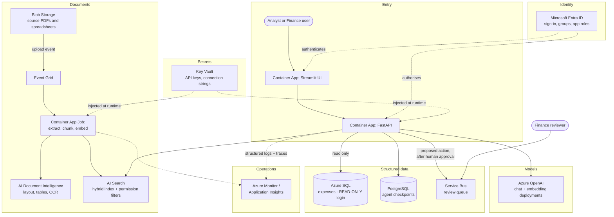

# Milestone 10 — the same design on Azure

This is a **mapping document**, not a deployment. Nothing here provisions anything,
and it assumes no subscription. Its purpose is to let you answer "how would you
build this on Azure?" with a real architecture rather than a list of product names.

The honest summary first: **the design does not change.** Every box in the local
system has an Azure equivalent, and the interesting part is not the substitution —
it is which substitutions are forced, which are optional, and what each one costs
you in money and in freedom.

## The mapping

| Local | Azure | Required? | What it replaces, and what changes |
| --- | --- | --- | --- |
| OpenAI API | **Azure OpenAI** | Required if you need data residency or an enterprise agreement | Same models, deployed per-region under your tenant. You deploy a *named deployment*, and your code refers to the deployment name, not the model name — a real code change, and the usual first surprise |
| Chroma (local folder) | **Azure AI Search** | Required | Replaces the vector store AND gives you hybrid search (keyword + vector) in one query, which this project does not have locally. Also brings filters that can enforce per-user document permissions at retrieval time — the blocking gap in `DEPLOYMENT.md` |
| SQLite file | **Azure SQL Database** (or PostgreSQL Flexible Server) | Required | Concurrent writes, backups, point-in-time restore, and — the important one — a read-only login so the text-to-SQL tool's permissions are enforced by the database, not by our regex |
| `data/raw/` folder | **Azure Blob Storage** | Required | Documents live outside the container. An upload can then trigger re-indexing through Event Grid |
| pdfplumber | **Azure AI Document Intelligence** | Optional, strongly recommended | Far better on real-world layouts: multi-column pages, rotated tables, stamps — and it does OCR, which closes the scanned-document gap |
| `.env` file | **Azure Key Vault** | Required | Secrets injected at runtime, with rotation and an access audit. The app reads them as environment variables, so `config.py` needs no change at all |
| uvicorn on localhost | **Azure Container Apps** | Required | Runs the existing Dockerfile. Scales to zero, which matters for an internal tool used in bursts. App Service is the alternative if you want something simpler and always-on |
| Streamlit | **Container Apps** (a second app) | Optional | Runs as-is. For anything customer-facing you would replace it — see the limitation in `ui.py` |
| structlog to stdout | **Azure Monitor / Application Insights** | Required | `LOG_JSON=true` already emits one JSON object per line, which is exactly what it ingests. The redactor matters more here, not less |
| Langfuse | **Application Insights**, or self-hosted Langfuse in a container | Optional | App Insights gives you request tracing and alerting; Langfuse gives better LLM-specific views. Many teams run both |
| LangGraph SQLite checkpointer | **PostgreSQL checkpointer** on Azure | Required | A SQLite file cannot be shared between container replicas, so human-approval pauses would break the moment you scale past one instance |
| review-queue.jsonl | **Azure SQL table**, or a Service Bus queue | Required | A JSONL file is not a work queue. Service Bus gives at-least-once delivery, dead-lettering and a real reviewer workflow |
| no authentication | **Microsoft Entra ID** | **Blocking** | The first thing to build, not the last. Everything in the permissions gap depends on having an authenticated user |

## The architecture

## How to read that diagram

Three things in it are the point, and the rest is plumbing.

**Entra ID touches both apps with dotted lines.** That is the gap this whole
document is really about. Once there is an authenticated user, AI Search can filter
retrieval by that user's groups and Azure SQL can enforce row-level security. The
model is never asked to keep a secret, because it is never given one.

**The arrow into Azure SQL says "read only".** The permission is a database login,
not a regex. Our four local safety layers were defence in depth around a file; on
Azure, layer four becomes a real credential that cannot be talked around.

**The write path goes through a queue, after human approval.** The agent proposes;
a human approves; only then does a message reach Service Bus. Nothing the agent
does reaches the queue without that step, exactly as the local graph's interrupt
works today.

## What costs money, and what does not

Stated as categories, not prices — prices change and should be checked against the
Azure pricing calculator rather than trusted from any document, including this one.

| Charges | Notes |
| --- | --- |
| **Azure OpenAI** | Per token, as now. Usually the largest line for a low-traffic internal tool |
| **AI Search** | Per hour for the service tier, **whether or not you query it**. This is the one that surprises people: an idle index still costs money every hour. There is a free tier with hard index-size limits |
| **AI Document Intelligence** | Per page processed. Only on ingestion, so it is a one-off per document |
| **Azure SQL** | Per hour, or serverless with auto-pause for an internal tool used in bursts |
| **Container Apps** | Per vCPU-second and GB-second. **Scales to zero**, so an internal tool genuinely costs nothing overnight |
| **Blob Storage** | Per GB. Negligible for documents |
| **Service Bus** | Per operation. Negligible at review-queue volumes |
| **Application Insights** | Per GB ingested. Worth watching: verbose logging is how this becomes a surprise |
| **Key Vault** | Per 10,000 operations. Effectively free — cache the secret at startup rather than reading it per request |
| **Entra ID** | Included in standard Microsoft 365 tenancies for this use |

The shape to remember: **AI Search and Azure SQL bill for existing; OpenAI and
Document Intelligence bill for using; Container Apps bills for running and can
drop to zero.**

## What changes in the code

Less than people expect, which is the real payoff of having gone through
`LLMClient` for every model call.

1. **`llm/client.py`** — swap `OpenAI` for `AzureOpenAI`, and refer to deployment
   names rather than model names. One class.
2. **`rag/index.py`** — replace Chroma with AI Search. The `VectorIndex` wrapper and
   the manifest check stay; this is why that wrapper exists.
3. **`tools/sql_safety.py`** — swap the SQLite connection for Azure SQL. Keep every
   validation layer, and **add** the read-only login. The authorizer callback is
   SQLite-specific and is replaced by database permissions, which is an upgrade.
4. **`graph/build.py`** — PostgreSQL checkpointer instead of SQLite.
5. **New: an auth dependency on the API**, and a user identity threaded into
   retrieval. This is the largest piece of work, and nothing else should ship first.
6. **`config.py`** — more settings, no structural change. Key Vault injects them as
   environment variables, which is what it already reads.

Unchanged: the graph, every node, the guardrails, the tool contract, the evaluation
harness, the verifier. The *design* was never about which vendor's box held the
vectors.

## Honest limitations of this document

- Not deployed. Nothing here has been run on Azure.
- No Bicep or Terraform. A real version needs infrastructure as code, because a
  hand-clicked environment cannot be recreated.
- No networking detail. A real deployment uses private endpoints and a VNet so the
  database is not reachable from the internet; that is a design exercise of its own.
- No cost estimate. The categories above are the useful part; a number would be
  invented.
