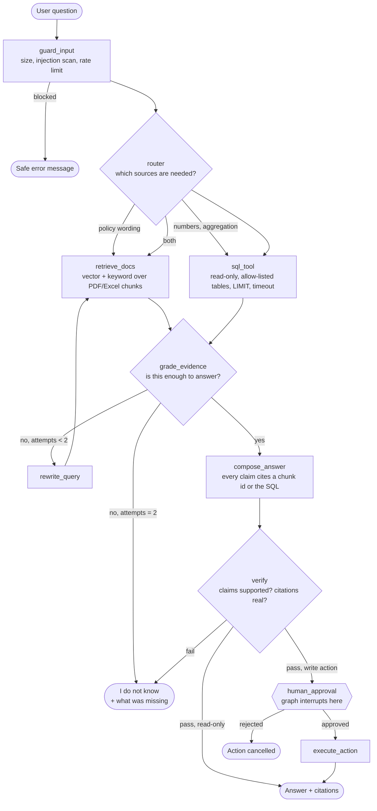

# PolicyDesk — plan and architecture

This file is the contract for the build. Read it at the start of any session to
know where we are and why things are the way they are.

## The scenario

A fictional company, **Northwind Labs**. It has expense and travel policies as
PDFs, submitted expense reports as Excel files, and an expense database.
PolicyDesk answers employee and finance questions across all three.

## Why this scenario

An agent is only worth building when a question exists that plain RAG cannot
answer. This scenario produces five question types, each forcing one component
of the system into existence:

| Question type | Example | Forces |
| --- | --- | --- |
| Policy lookup | "Per-diem for international travel?" | Document RAG (the baseline) |
| Aggregate number | "Engineering travel spend in Q3?" | Text-to-SQL; the model must not invent numbers |
| **Cross-source** | "Which of Priya's October expenses break policy?" | **The agent itself** — PDF limit + SQL rows + comparison |
| Out of scope | "Parental leave policy?" | Honest refusal instead of a guess |
| Action | "Flag expense 4412 for escalation" | Human approval before a write |

## Target architecture

**How to read it.** Rectangles are nodes — a Python function or a model call.
Diamonds are conditional edges: a decision made while running. The arrow from
`grade_evidence` back to `retrieve_docs` is a **cycle**, which is exactly what a
simple chain cannot express. The double-bordered box is an **interrupt**: the
graph saves its state and stops until a human answers. The three separate
failure exits are deliberate — designing honest failure paths is most of what
separates a demo from a system.

## Technology choices

Chosen for being widely used in industry, not for being novel.

| Area | Choice | Note |
| --- | --- | --- |
| Orchestration | LangGraph | State machine with cycles, retries, interrupts |
| LLM plumbing | LangChain (thin) | Loaders, splitters, retriever interfaces only |
| Vector store | Chroma (local) | Fine for learning. **Not** a production vector store — see gap list |
| Structured data | SQLite | No server to run |
| Model provider | OpenAI, behind an abstraction | Swappable to Azure OpenAI, Gemini or Ollama via `.env` |
| Observability | Langfuse, self-hosted via Docker | Optional; app works without it |
| Tool protocol | MCP | Current standard for exposing tools to agents |
| API / UI | FastAPI + Streamlit | Enough to be real |
| Quality | pytest, ruff, GitHub Actions | |

Deliberately **not** used: fine-tuning, prompt-optimisation research frameworks,
agent-to-agent protocols. Out of scope and not yet common in production.

## Milestones

Each is small and independently verifiable. ✍️ marks a decision you write
yourself, because your judgement matters more than boilerplate there.

| # | Milestone | What you learn | Status |
| --- | --- | --- | --- |
| 0 | Skeleton, config, secrets, logging, tests | Why layout and secret handling come first | done |
| 1 | Sample data + PDF/Excel extraction with metadata | Why page/sheet/row metadata is what makes citations possible | in progress |
| 2 | Plain RAG baseline, chunk inspector, "I do not know" ✍️ chunking | **When plain RAG is enough** | |
| 3 | Tools: text-to-SQL + policy lookup ✍️ SQL validator rules | Tool contracts; numbers never come from the model | |
| 4 | LangGraph: state, router, bounded retry loop, interrupt ✍️ router policy | State machines vs chains vs free-running agents | |
| 5 | Guardrails + red-team tests | Why a prompt is not a security boundary | |
| 6 | MCP server + client | Protocol vs in-process function calling | |
| 7 | Evaluation: Recall@k, MRR, groundedness, citation and tool-choice checks ✍️ eval set | What each metric does and does not tell you | |
| 8 | Langfuse traces, cost, latency, redaction | Debugging one slow request end to end | |
| 9 | FastAPI, UI, Docker, CI, versioning and rollback | Why Docker + tests ≠ production ready | |
| 10 | Azure reference mapping + diagram (docs only) | Local → Azure translation, with costs flagged | |

## What this is NOT (the production gap list)

Kept honest and updated as we go. A real deployment would also need:

- A managed vector store with backups and access control, not a local Chroma folder
- Per-user authentication and document-level permissions enforced **at retrieval
  time**, not in the prompt
- A real database with least-privilege credentials, not a SQLite file
- Rate limiting and spend caps enforced per user and per tenant
- An on-call story: alerts, dashboards, runbooks, error budgets
- Data retention and deletion rules for anything containing personal data
- A human review process for low-confidence answers before they reach anyone senior
- Load testing, and a measured answer for cost and latency per question
